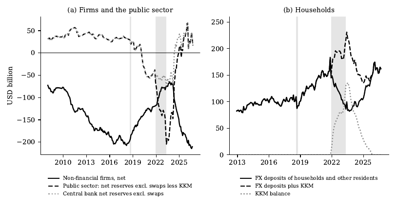

# Relocating the External Constraint

Data and code behind every table and figure of

> Aslan, I. (2026). Relocating the external constraint: Currency risk, corporate fragility and the state in Turkey. Working paper, November 2026. [Abstract and PDF](https://ilkeraslan.github.io/papers/relocating-the-external-constraint.html)



An economy whose firms borrow in foreign currency and whose production depends on imports carries an open foreign-currency position. Domestic policy can move that position between sectors but cannot remove it. The paper documents this for Turkey between 2013 and 2026 with trade elasticities, central bank statistics on sectoral foreign-currency positions, company accounts by NACE division and the accounts of the exchange-rate-protected deposit scheme (KKM).

## Main results

| | Estimate |
|---|---|
| Income elasticity of imports, 1987–2025 | 1.53 (dynamic OLS), 1.97 (first differences) |
| Growth since 2018 against the balance-of-payments-constrained rate | above it by one to two points a year |
| Net foreign-currency liabilities of non-financial firms | USD 200 billion (July 2018), USD 73 billion (May 2023), USD 210 billion (September 2026) |
| Public sector position: net reserves excluding swaps less the KKM balance | USD +30 billion, −205 billion, +31 billion at the same dates |
| Change in the public position per dollar of change in firms' position, quarterly | −0.92 (s.e. 0.29) |
| Asset share of sectors whose operating profit is below financing expenses | 36 per cent in 2018 and 2021, 13 per cent in 2022, 46 per cent in 2024 |
| Payments under the KKM scheme, 2022–2025 | TRY 1.46 trillion, about USD 59 billion |

## Files

| Path | Content |
|---|---|
| `data/` | The source files as downloaded (see Data) |
| `code/build.py` | Sectoral foreign-currency positions and the sector panel from company accounts |
| `code/thirlwall.py` | Import and export demand functions and the constrained growth rate (Tables 1 and 2) |
| `code/kkm.py` | Model estimate of KKM compensation |
| `code/minsky.py` | Hedge, speculative and Ponzi classification of sectors and the baseline regressions |
| `code/extra.py` | Episode accounting, quarterly trade equations, robustness of the sector regressions |
| `code/figtab.py` | Figures and table bodies |
| `code/identity.py` | External counterpart of the sectoral positions, offset regressions, quarterly cointegration (Tables 4 and 5) |
| `results/` | Outputs of the code: intermediate data (`*.csv`), estimates (`*.json`), table bodies (`tab_*.tex`) and figures (`fig_*.pdf`) |

Tables and figures by file: Table 1 `tab_elast`, 2 `tab_periods`, 3 `tab_positions`, 4 `tab_offset`, 5 `tab_external`, 6 `tab_minsky`, 7 `tab_reg`, 8 `tab_kkm`; Figure 1 `fig_thirlwall`, 2 `fig_positions`, 3 `fig_minsky`, 4 `fig_kkm`.

## Running the code

```
python -m pip install -r requirements.txt
cd code
python build.py
python thirlwall.py
python kkm.py
python minsky.py
python extra.py
python figtab.py
python identity.py
```

Run the scripts from the `code` folder in this order; together they take under a minute and reproduce the files in `results/`. They were last checked with Python 3.13, pandas 3.0, NumPy 2.5, statsmodels 0.15, SciPy 1.18 and Matplotlib 3.11.

## Data

All series are public and were retrieved on 24 November 2026.

| File | Source |
|---|---|
| `tr_monthly.csv`, `tr_money.csv`, `tr_fx_monthly.csv` | Monthly series from the Electronic Data Delivery System (EVDS) of the Central Bank of the Republic of Türkiye |
| `tr_quarterly.csv` | Quarterly series from EVDS (national accounts, external debt) |
| `tr_company_accounts.csv`, `tr_company_ratios.csv` | Annual company accounts by NACE division, EVDS |
| `tr_iip.csv` | International investment position and related series, EVDS |
| `wb_annual.csv`, `wb_cpi.csv` | World Development Indicators, World Bank |

Each EVDS file has the columns `group` (EVDS data group), `code` (series code), `name`, `date` and `value`.

The payments under the KKM scheme in Table 8 are not in the data files. They are entered in `code/figtab.py` with their sources: the budget realisations of the Ministry of Treasury and Finance (2022: TRY 92.5 billion; January–July 2023: TRY 59.5 billion) and the notes to the profit and loss statements in the CBRT Annual Reports 2023, 2024 and 2025 (TRY 72.8 billion, 833.4 billion, 240.2 billion and 166.5 billion for 2022 to 2025).

## Citation

Please cite the paper. GitHub's "Cite this repository" button gives the reference in APA and BibTeX formats.

## Licence

Code: MIT licence (see `LICENSE`). The data are from the public sources listed above and remain subject to their terms.

## Author

Ilker Aslan, Lecturer, Kalaidos University of Applied Sciences, Zürich
[ORCID 0000-0001-9241-9420](https://orcid.org/0000-0001-9241-9420) · [ilkeraslan.github.io](https://ilkeraslan.github.io)
